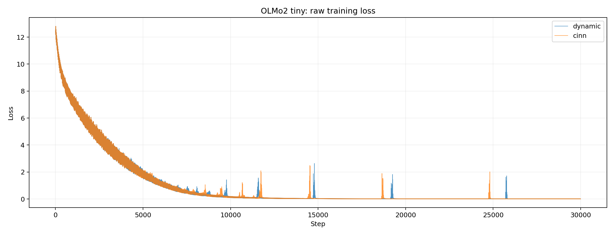
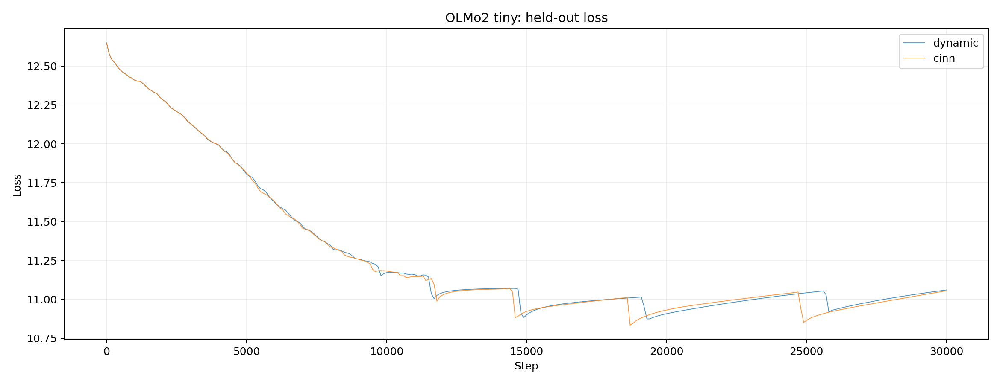

# OLMo2 tiny：30000步 CINN 对比

2026-10-07完成。随机2层/hidden64/FFN128，12,919,296参数；V100S 32GB、FP32、关闭TF32、batch1、seq64，GSM8K 20训练/4留出。不是预训练缩层。两端从完全相同初始权重训练，各10000步后恢复各自模型、优化器和随机状态，续至30000步。完整日志连续且有限。

| 项目 | 动态图 | CINN | 吞吐提升 |
|---|---:|---:|---:|
| 稳态训练 ms/step | 10.258 | 3.231 | 217.47% |
| 训练样本/秒 | 97.48 | 309.49 | 217.47% |
| 同权重独立前向 ms | 4.687 | 0.788 | 494.58% |
| 前向样本/秒 | 213.33 | 1268.45 | 494.58% |
| 训练步数 | 30000 | 30000 | — |
| 首100步平均训练loss | 11.982512 | 11.982512 | — |
| 末500步平均训练loss | 0.003588 | 0.003526 | — |
| 前一个500步窗口平均loss | 0.003715 | 0.003642 | — |
| 最终留出loss | 11.060065 | 11.054883 | — |

按已确认的框架测试口径，两端已充分拟合训练子集。留出loss仍高，不能称泛化收敛或GSM8K任务精度通过。训练途中存在孤立尖峰，两端逐步loss不严格一致（全程最大差2.605，尾10% MAE 0.000163），不将曲线趋势接近写成逐步精确对齐。

## 编译与复验

默认整个模型forward使用`to_static(full_graph=True, backend="CINN")`，loss和优化器保留动态；仅配置get保持Python读取。无算子黑名单、Norm替换、模型数学公式修改。确认CINN编译标记，并非仅调用动转静接口。

独立前向使用相同动态图30000步最终权重，两端不同进程，预热10/计时30次、逐次GPU同步。logits最大绝对差1.383e-5。训练每个进程剔除前100步后取中位数；单次配对，非多次统计显著性检验，也不是生成/端到端耗时。吞吐提升=(动态耗时/CINN耗时−1)×100%；首次编译不计入稳态收益。

公开源码基线加补丁已在新worktree还原，Git tree与历史快照一致；便携脚本两端20步及独立推理通过。25项参数梯度均存在且有限，无非零梯度消失，首步梯度最大差7.391e-6；便携入口与原烟测loss最大差均9.537e-7。

旧完整1B模型默认编译崩溃仍未修复，本次只证明tiny配置可行。原1B报告和问题复现保留，不被本结果覆盖。

## 材料

- 完整指标及分段原始日志目录：[comparison.json](comparison.json)
- 测试入口：[run_model.py](../run_model.py)，运行方法见[run_model.md](../run_model.md)。
- 原始逐步日志：`logs/{dynamic,cinn}{10000,30000}/`。comparison.json内的绝对路径仅记录原实验位置，日志副本已随本目录提供。
- 本目录包含环境说明、源码补丁、tokenizer、数据和资产哈希；权重不上传，需另行提供与asset_manifest.json匹配的文件。
